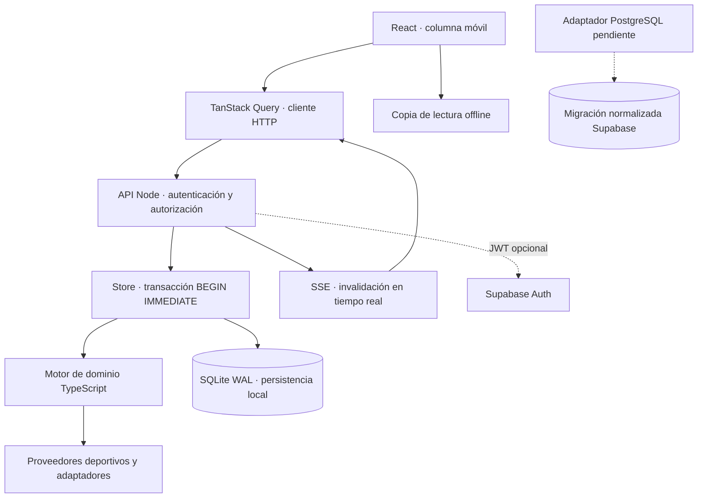

# Arquitectura

`shared/types.ts` contiene modelos internos; `config.ts`, catálogos reutilizables; `engine.ts`, operaciones; `math.ts`, dinero, puntos y horarios; `sports.ts`, proveedores y validación. El navegador importa únicamente consultas puras y catálogos del motor. La autoridad económica está en el servidor; enviar una cantidad o reloj diferentes no permite alterar el estado directamente.

`server/store.ts` agrupa autenticación local, sesiones, membresías, persistencia, idempotencia y ejecución transaccional. `server/index.ts` expone HTTP, SSE, reconciliación periódica y contenido estático de producción. `server/supabase.ts` valida tokens con `auth.getUser` antes de crear una sesión del backend. No se usa una clave de servicio en el navegador.

Cada operación carga una copia del agregado desde SQLite, reconcilia vencimientos, autoriza, ejecuta y guarda dentro de `BEGIN IMMEDIATE`. Las excepciones provocan rollback. No se hace I/O asíncrono dentro de la transacción. Con un único proceso propietario de la base, operaciones simultáneas se serializan. No se afirma soporte de clúster, réplicas de escritura ni varios servidores con copias independientes.

Las respuestas pasan por `publicState`: eliminan la semilla privada, pujas rivales abiertas, invitaciones ajenas y negociaciones de terceros. El libro mayor es privado. Los saldos de clubes son públicos porque alimentan rankings económicos. SSE solo transmite invalidaciones; cada consulta de datos vuelve a comprobar sesión y membresía. Un sondeo de quince segundos sirve de recuperación.

Los procesos se reconcilian en orden cronológico: trabajos, subastas, mercado y ciclo diario, cierre de convocatorias, partidos y liquidaciones. Un bucle cada cinco segundos permite avanzar sin navegadores conectados mientras el servidor siga activo. Tras una parada, la siguiente lectura u operación recupera vencimientos. El reloj del cliente solo anima contadores; no produce ingresos ni finaliza trabajos.

Los marcadores de cierre, estado de trabajos, liquidaciones y premios impiden repetir efectos. Las claves de idempotencia son obligatorias en HTTP. Si una respuesta económica se pierde, el cliente conserva la clave de la misma operación hasta recibir una confirmación; no encola acciones offline.

React Router divide los destinos; las pantallas se cargan con `lazy`. CSS y SVG originales evitan un motor de mapa pesado. Las animaciones respetan `prefers-reduced-motion`. La PWA precachea recursos del build, nunca respuestas de operaciones. La última copia de la partida se guarda por usuario y es únicamente de consulta. La sesión pública mínima se conserva en la pestaña para permitir recarga offline; la cookie de autenticación sigue siendo HttpOnly. Cerrar sesión elimina la copia de ese usuario.

Limitación arquitectónica deliberada: el adaptador local persiste el agregado de liga como JSON transaccional, junto a tablas normalizadas de usuarios, sesiones, membresías, recibos y logs. El esquema PostgreSQL de 69 tablas prepara la futura persistencia normalizada de los dominios; todavía no sustituye a `Store`.
