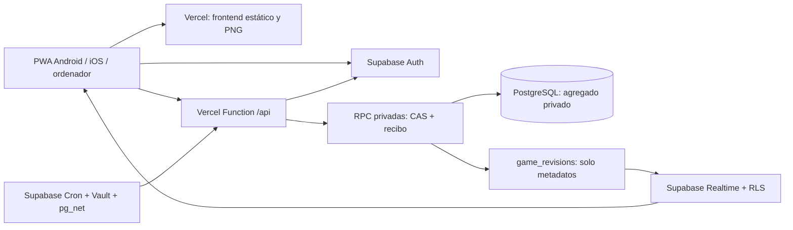

# Arquitectura online de Monigones

## Persistencia real, sin bifurcar las reglas

`server/online/store.ts` implementa `PostgresStore`, con `server/online/transport.ts` como transporte PostgREST HTTPS. No es una interfaz vacía. El mismo `shared/engine.ts` de v0.3 calcula todos los comandos y vencimientos. `api/[...path].ts` adapta HTTP a `server/online/handler.ts`; Vercel invoca esta Function por petición, sin mantener el proceso del Mac ni un servidor Node dedicado. No importa `server/index.ts`, `server/store.ts`, `node:sqlite` ni funciones de escritura en disco.

Se eligió JSONB por liga en lugar de reimplementar las 42 operaciones del motor en el esquema normalizado histórico de 69 tablas. Así se conservan reglas, actividades v0.3, colas, avisos, temporadas, informes, economía y campos nuevos sin crear dos versiones del dominio. Las tablas normalizadas se validan y conservan, pero no son una segunda fuente activa de saldos, contratos o resultados. La RPC de puja de ejemplo deja de ser ejecutable por clientes autenticados para evitar ese camino desconectado.

El esquema `monigones_private` contiene `games`, `receipts` y `rate_limits`. RLS está habilitada y no hay permisos para anon/authenticated. El API schema público no expone el agregado. `public.memberships` asocia Auth, liga y club; `public.game_revisions` solo publica ID de liga, revisión y fecha.

## Comando y atomicidad

1. El navegador renueva su JWT con Supabase Auth y lo envía como Bearer a la Function.
2. La Function verifica el JWT con `Auth.getUser`; el cliente no elige usuario, club ni privilegios. Los límites de frecuencia se guardan en PostgreSQL, no en memoria de una instancia serverless.
3. `online_load` devuelve al backend el snapshot privado y el reloj de PostgreSQL. El motor reconcilia vencimientos antes de ejecutar la acción.
4. `online_commit` bloquea perfil y liga en orden fijo, comprueba revisión, consulta recibo idempotente y confirma **estado entero + membresía + recibo + revisión pública** en la misma transacción.
5. Si cambió la revisión, el estado calculado se descarta y se vuelve a calcular desde el snapshot confirmado. No hay un overwrite por el último escritor. Hay reintentos limitados y la clave se conserva si falla la respuesta.
6. La respuesta usa `publicState`, conserva los filtros existentes de pujas, RNG, negociaciones, selección privada y avisos. Los nombres de presidentes provienen de perfiles Auth validados.

Un fallo SQL revierte todos los componentes del commit. Si se pierde la respuesta después de confirmar, repetir la misma clave consulta el recibo y no repite el efecto. Cambiar el comando reutilizando esa clave se rechaza. Los importes siguen siendo enteros en céntimos. La exclusión por liga permite concurrencia entre ligas y serializa las decisiones que comparten propietarios, plazas y recursos.

## RPC y permisos

| RPC                  | Función                                                       |
| -------------------- | ------------------------------------------------------------- |
| `online_health`      | Verificar disponibilidad de la migración y credenciales       |
| `online_profile`     | Sincronizar nombre validado de un usuario Auth existente      |
| `online_rate`        | Límite por cuenta y minuto persistente                        |
| `online_head`        | Revisión y reloj sin transferir el agregado                   |
| `online_load`        | Cargar snapshot por membresía o invitación para incorporación |
| `online_create`      | Crear liga, estado y membresía atómicamente                   |
| `online_receipt`     | Resolver un reintento o detectar una clave reutilizada        |
| `online_commit`      | Compare-and-swap transaccional, recibo y señal Realtime       |
| `online_claim_due`   | Reclamar trabajo vencido con SKIP LOCKED y concesión temporal |
| `online_tick_failed` | Registrar fallo y programar recuperación desde checkpoint     |
| `online_load_league` | Recargar para reintento de un worker autorizado               |

Todas son SECURITY DEFINER con search_path cerrado y ejecución solo para `service_role`. La clave privada vive únicamente en Vercel. El navegador no puede invocarlas directamente ni escribir membresías, revisiones o saldos. Las pruebas ejecutan las funciones con el rol real de servicio y verifican denegaciones con anon y authenticated.

[Inventario completo de operaciones](ONLINE_OPERATIONS.csv): los 42 casos del motor se canalizan por el mismo adaptador transaccional, incluidos mercado, negociaciones, draft, plantilla, convocatoria, obras, investigación, recompensas, patrocinio, conciertos, instituciones, entrenadores, cantera, chat y temporadas. Las dos operaciones del laboratorio continúan limitadas al modo local.

## Realtime, lectura y caché

Supabase Realtime publica únicamente `game_revisions`, bajo RLS de membresía. Un cambio invalida la consulta de la liga, con coalescencia de 200 ms. No se publican el JSON completo ni pujas secretas. Tras suscribirse o recuperar el foco se consulta la vista; el sondeo de respaldo es cada 60 segundos. ETag/304 evita retransmitir datos sin cambios y devuelve el reloj de servidor en una cabecera. Las respuestas viajan por streaming finito, con gzip cuando se admite y backpressure, para conservar históricos que superarían los 4,5 MB de una respuesta buffered en Vercel.

Auth usa una sola instancia del SDK, sesión persistida y renovación automática. La copia offline distingue proyecto y usuario; el cierre de sesión limpia esa copia. El modo local conserva sus claves anteriores, su cookie HttpOnly y SSE. No se hace fallback silencioso de PostgreSQL a SQLite en producción.

## Procesos programados

La activación remota está en `supabase/setup-cron.sql`, separada de las migraciones de datos porque depende de un endpoint publicado y secretos Vault que aquí no existen. `pg_cron` llama cada minuto por `pg_net` a `/api/cron`. Solo usa un secreto dedicado a ese endpoint, sin dar al cron toda la clave de la base.

Cada lote reclama hasta diez ligas vencidas con `FOR UPDATE SKIP LOCKED`, token y concesión de dos minutos. Procesa dentro de un presupuesto de 45 segundos y confirma mediante el mismo CAS. Concesiones no procesadas o procesos caídos caducan; fallos explícitos guardan el error y vuelven a estar disponibles. Un conflicto con una acción de usuario se recalcula desde el nuevo estado.

El próximo vencimiento incluye mercado/cierre diario, trabajos, subastas, bloqueos e hitos de partido, final de actividad y conciertos. La actividad terminada genera disponibilidad/aviso; la recompensa sigue siendo manual. La reconciliación cronológica existente conserva cobros únicos, liquidaciones y las 06:00 de Europe/Madrid, incluidos cambios de horario. No se acepta tiempo del dispositivo.

## Gráficos y publicación

Canvas, atlas, edificios, sonido y los 522 PNG se conservan. Local sigue detectando sustituciones desde `public` cada cinco segundos. Online genera un manifiesto de hashes al construir; el CDN sirve PNG inmutables por contenido de URL versionada y revalida el manifiesto. Para incorporar un PNG hay que publicarlo en un despliegue nuevo; no se escribe en el filesystem efímero de Functions. La PWA usa NetworkFirst para imágenes y mantiene los fallbacks y el código precargados.

## Límites de la verificación

Se ejecutan PostgreSQL 17 nativo, migraciones, seed, roles, funciones, permisos, conflictos y navegadores. Los contratos HTTP Auth/RPC y WebSocket se ejercitan con fixtures explícitos delante de PostgreSQL real. No se ha levantado un stack completo Supabase oficial ni se ha probado el runtime de Vercel remoto. La activación efectiva de publicación Realtime, correo, `pg_net`, Vault, cron y políticas bajo PostgREST alojado queda para la aceptación remota autorizada. La arquitectura no depende de esos fixtures en producción.
